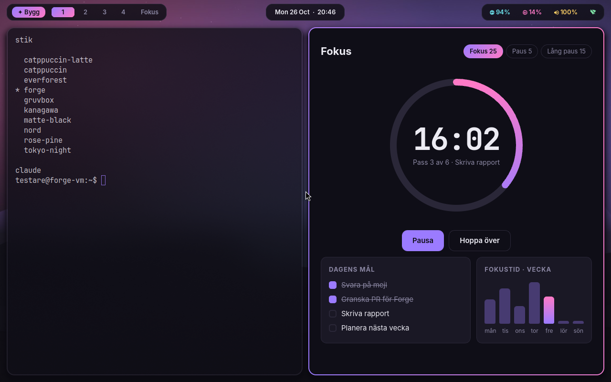
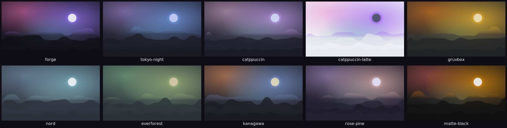

# Forge OS

**Ett Linux-system där du beskriver vad du vill ha — och AI:n bygger det.**
Appar *och* själva operativsystemet. Allt sparas, versioneras och går att ångra.



<sub>Riktig skärmdump: Forge OS installerat på Ubuntu 26.04 och uppstartat i en virtuell maskin
(`tests/vm/run.sh`) — greetd, Hyprland 0.53, Waybar, temat `forge` och exempelappen Fokus i sitt
eget fönster. Maskinen saknar grafikkort och ritar i mjukvara.</sub>

> Arbetsnamn. Byggt på Ubuntu LTS (stabilt), med ett Omarchy-inspirerat Hyprland-skrivbord
> (snyggt, tangentbordet först) och Claude Code + Codex inbyggda (vibe) — i molnet eller lokalt.

```
Super+A          "en timer som pausar Spotify när jag fokuserar"   → ny app i appmenyn
Super+E          "lägg till statistik per vecka"                  → ändrar appen du tittar på
Super+Shift+A    "gör allt mörkare och byt Super+W till Super+Q"  → ändrar själva systemet
Super+Shift+T    nästa tema                                        → hela systemet + alla appar
```

## Teman



Tio teman från start — `forge`, `tokyo-night`, `catppuccin`, `catppuccin-latte`, `gruvbox`, `nord`,
`everforest`, `kanagawa`, `rose-pine`, `matte-black` — var och en med egen bakgrundsbild.
`forge theme <namn>` byter färg på Hyprland-ramar (gradient), panel, terminal, appstartare, notiser,
låsskärm **och alla dina appar** på en gång. Säg "gör ett tema som känns som en höstskog" så skriver
agenten ett nytt. Effekterna — blur, skuggor, rundade hörn, animationer — ligger i Hyprland-konfigen.

## Idén: tre saker ihop

| Inspiration | Vad vi tar | Hur det blir i Forge |
|---|---|---|
| **vibeOS** (vibeos.sh) | "Mjukvara du ändrar genom att be om det", även skrivbordet | Hela systemet är ett git-repo (`~/Forge/system`) som agenten redigerar. Du ser diffen, godkänner, `forge system apply` verkställer. Skillnad: riktig installation på riktig hårdvara, inte en VM i en flik. |
| **Google Play — vibe-kodade appar** (okt 2026) | Personligt bibliotek, privat delning med säkerhetsgranskning, väg till publicering | `forge sync` = ditt bibliotek i privata git-repon. `forge share`/`forge install` = privat delning, där agenten säkerhetsgranskar appen innan den installeras. Flatpak/Flathub som väg ut. |
| **REA** (morluto/rea) | Låt agenten förstå befintliga program | Förinstallerad MCP. "Gör en app som funkar som X" → agenten undersöker X:s beteende och bygger en *egen* version (skill: `forge-rebuild-from-reference`). |

Plus: **18 skills** som följer med distrot och laddas i både Claude Code och Codex — appbygge, design,
data, behörigheter, AI i appar, systemändringar, Hyprland, teman, lokal AI, paket, tjänster, delning,
säkerhetsgranskning, felsökning m.m. Se [`skills/`](skills/).

## Lokal AI — samma verktyg

```
forge agent local                                   # gpt-oss:20b via Codex
forge agent local qwen3-coder:30b --engine claude   # Claude Code mot en lokal modell
forge agent claude                                  # tillbaka till molnet
```
Agenten är fortfarande Claude Code eller Codex — samma verktyg för filer, terminal, MCP (REA) och
skills — bara modellen körs på din dator via Ollama. Inget lämnar maskinen.

## Så funkar det

- **Appar** = `~/Apps/<namn>/`, ett git-repo per app med `forge.json`. Sparas för alltid, syns i
  appmenyn, varje ändring är en commit (`forge undo`). Appar får använda internet; deras filåtkomst
  är begränsad av en bubblewrap-sandlåda. Webbappar följer systemtemat automatiskt.
- **Systemet** = `~/Forge/system/` — paketlistor, dotfiles, `/etc`-filer, tjänster, teman, hooks.
  Agenten får bara ändra där och aldrig köra sudo. Det du tar bort ur repot tas bort från datorn.
  Ångra med `forge system rollback` (och btrfs-snapshots via snapper om du kör btrfs).
- **Agenten** = Claude Code, Codex eller lokal modell (`forge agent …`).

Detaljer: [docs/ARCHITECTURE.md](docs/ARCHITECTURE.md).

## Kom igång

På en Ubuntu 26.04 LTS (desktop eller server):
```bash
git clone https://github.com/Jtensetti/os && cd os
sudo ./install.sh
```
Logga ut, välj Hyprland, tryck **Super+A**. Eller bygg en installations-ISO: [iso/](iso/).

## Kommandon

```
forge new "beskrivning"         forge system "ändring"
forge edit <app> "ändring"      forge system diff | log | apply | rollback
forge run | list | history | undo | rm <app>
forge share <app> / forge install fil.forgeapp / forge sync
forge theme [namn|next]         forge agent claude|codex|local [modell]
forge update [--agent]          Forges nya standard, dina ändringar behålls
forge chat                      forge doctor
```

## Utveckla och testa

Forge är en *remix* av Ubuntu, inte en fork: allt kommer från Ubuntus egna arkiv (Hyprland 0.53
finns i universe i 26.04), och Forge lägger bara till sina program, konfig och skills ovanpå.
Säkerhetsuppdateringar kommer därför direkt från Ubuntu.

- `tests/run.sh` — hela forge-flödet med en låtsasagent (inget konto, ingen root).
- `sudo tests/install-check.sh` — verifierar ett installerat system.
- `sudo tests/vm/run.sh` — installerar på Ubuntu 26.04 och startar i en VM med Hyprland.
- `sudo tests/iso/run.sh` — bygger ISO:n, installerar den på en tom disk och startar den.
- CI installerar på `ubuntu:26.04` vid varje push.
Status: tidig MVP — se [roadmap](docs/ARCHITECTURE.md#roadmap).
